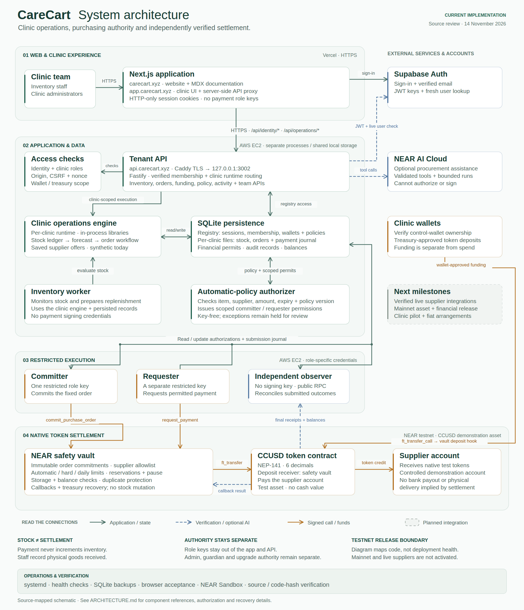

# CareCart architecture

CareCart connects clinic stock records, replenishment, purchasing policy and independently verified payments. This schematic maps the implemented application and deployment pattern as reviewed on November 14, 2026. It is not an attestation that every optional service is currently running.

[Open the scalable SVG](assets/architecture/carecart-architecture.svg) · [Download the PNG](assets/architecture/carecart-architecture.png)

Green connections carry application requests or state access. Dashed blue connections show identity checks, optional inference or independent chain reads. Amber connections carry signed contract calls or token movement. Grey dashed components are planned integrations. Components in the SVG link to their implementation.

## Application and hosting boundaries

| Boundary | Components and responsibilities | Implementation |
| --- | --- | --- |
| Clinic browser | Inventory, replenishment, suppliers, payments, activity and settings. Staff record physical stock movements; administrators configure permissions. | [Clinic routes](web/src/app/app) |
| Vercel application | `carecart.xyz` serves the website and MDX docs. `app.carecart.xyz` serves the clinic workspace. Next.js rewrites application paths internally and proxies authenticated API calls. | [Host routing](web/src/lib/application-routing.ts), [request proxy](web/src/proxy.ts), [API proxy](web/src/lib/identity-proxy.ts) |
| External identity | Supabase supplies sign-in, verified-email identity and JWT keys. The web server uses HTTP-only cookies; the backend independently verifies the JWT and performs a fresh Auth user lookup. | [Web identity](web/src/lib/identity-backend.ts), [backend identity](backend/src/tenancy/identity.ts) |
| EC2 API | Caddy terminates HTTPS for `api.carecart.xyz`; Fastify listens on loopback port 3002. The API enforces identity, clinic membership, permissions and request guards. | [Tenant server](backend/src/tenancy/server.ts), [tenant routes](backend/src/tenancy/api.ts) |
| Clinic runtime | The API opens clinic-specific operations in process. Child applications do not bind public sockets. A server-created, request-scoped capability carries the verified clinic principal. | [Runtime pool](backend/src/tenancy/runtime.ts) |
| External AI | Optional NEAR AI Cloud inference uses a bounded tool loop and validated results. Provider output cannot authorize or sign a payment. | [Provider adapter](backend/src/agent/live.ts), [procurement runs](backend/src/operations/runs.ts), [tools](backend/src/operations/tools.ts) |
| External wallets | Wallet ownership proofs bind purchasing control to the clinic. Treasury-approved token deposits are separate from authorizing supplier spending. | [Wallet bindings](backend/src/tenancy/wallet-bindings.ts), [funding UI](web/src/components/payment-account-panel.tsx) |

The backend uses SQLite for application data. Supabase is the identity provider, rather than the clinic inventory database. The frontend, tenant API and inventory worker reject payment signing credentials in their environments.

## Stock-to-payment flow

1. **Record stock.** Staff receive, dispense, consume or adjust supplies. The ledger persists movements, batch information and audit records.
2. **Evaluate replenishment.** The inventory worker opens the clinic engine, evaluates recorded stock and usage, compares configured supplier offers and prepares a fixed purchase order when the clinic's monitoring settings permit it. Supplier offers are synthetic in the current release.
3. **Apply standing authority.** The key-free authorizer evaluates the clinic's current policy, treasury configuration, selected items, approved suppliers, amount, expiry and order revision. It issues a role-specific financial authorization only when the order qualifies. Policy changes or revocation invalidate stale authority.
4. **Commit the order.** The committer process consumes an authorization scoped to its role and commits the canonical order to the safety vault. Its key is isolated from the requester.
5. **Request payment.** After the workflow reaches the payment-request step, a separate requester authorization permits the requester process to call the vault. Workers execute existing authority; they do not approve their own orders.
6. **Execute on NEAR.** The vault checks the commitment, role, supplier, limits, pause status and available funds. It reserves funds, calls the configured token contract and updates payment state through the callback result.
7. **Verify independently.** The key-free observer checks final public-chain evidence and reconciles submitted operations, payment state and balances. Submission alone does not prove a supplier payment. Consumed or uncertain intents are not automatically returned to the send queue.
8. **Receive the supplies.** Staff record a separate goods receipt after checking delivery. A payment or callback never increments stock.

The inventory worker, policy authorizer, committer, requester and observer are distinct responsibilities. The latter four are supported modes of the payment-worker entry point; deployed service activation depends on the configured clinic and environment.

## Persistence

| Store | Contents | Access |
| --- | --- | --- |
| Registry SQLite file | Clinics, membership, identity sessions, wallet bindings, treasury configurations, policy versions and related authority records. | Tenant API and scoped workers. |
| Separate clinic SQLite files | Inventory movements, forecasts, supplier catalog, replenishment cases, financial authorizations, operation journals and audit records. | Clinic runtime and workers operating on that clinic. |
| NEAR contract state | Order commitments, roles, supplier permissions, vault policy, reservations and payment outcomes. | Restricted contract calls and public RPC reads. |
| Public receipt evidence | Recorded transaction references, final receipt checks, historical balance deltas and source verification. | Reproducible read-only checks in [docs/evidence](docs/evidence). |

[Runtime selection](backend/src/tenancy/runtime.ts) binds a clinic to its configured storage and testnet profile. [Financial authorization](backend/src/operations/financial-authorizations.ts) and [treasury authority](backend/src/tenancy/treasury-authority.ts) bind execution to the clinic, role, policy, exact order and profile. Database and authorization metadata do not replace verification of chain outcomes.

## Funding, authority and recovery

- **Deposits:** the treasury wallet calls the configured token's `ft_transfer_call` with the vault as receiver and `deposit` as its message. The vault credits accepted spendable funds through its deposit hook; a plain token transfer is not an accounted deposit. The UI builds the transfer for wallet review and subsequently checks its outcome.
- **Restricted execution:** committer and requester processes receive only their own role credentials. Role-specific environment files and Linux service accounts separate them from the API and inventory worker. Authorizer and observer modes require no signing credentials.
- **Contract controls:** the vault enforces supplier permissions, automatic and hard per-order limits, daily dispatch limits, deposits, reservations and pause controls. Failed transfer callbacks restore reservations according to the contract's accounting rules.
- **Administrative authority:** admin, guardian and treasury roles are separate from payment workers. Guardian authority is pause-only. Treasury withdrawal and emergency recovery target the configured treasury. A full-access contract-account key can replace deployed code and remains a separate trust assumption.
- **Held orders:** the current public tenant app does not complete the human-admin wallet handoff for held payments. Those orders remain held; hard limits cannot be overridden by approval. Local Sandbox tests cover the contract approval path.
- **Uncertain outcomes:** reconciliation precedes any decision about further action. Worker restart is not permission to resend an ambiguous payment.

See [role credentials](backend/src/ops/role-credentials.ts), [payment workers](backend/src/ops/testnet-payment-worker.ts), [scoped execution](backend/src/ops/tenant-financial.ts), [safety-vault source](contracts/carecart-safety-vault/src/lib.rs) and the [EC2 service guide](backend/deploy/ec2/README.md).

## Operations and verification

The EC2 deployment uses supervised processes, Caddy and local SQLite storage. Backups must cover the registry and clinic databases with appropriate SQLite consistency handling; the repository includes [backup tooling](scripts/backup-carecart.py). Backup restoration remains a separate operating rehearsal required by the readiness guide. The [API health route](backend/src/tenancy/api.ts) and service journals support operational checks without asserting that a payment succeeded.

Verification spans several independent layers:

- Backend and frontend tests, type checks, lint and isolated production builds: [verification script](scripts/verify-phase2.sh).
- Browser stock workflow and duplicate receiving: [browser acceptance](scripts/mvp-browser-acceptance.mjs).
- Contract policy and real local receipt execution: [safety-vault tests](contracts/carecart-safety-vault/tests).
- Public testnet payment, duplicate protection, historical balances and deployed source reproduction: [judge walkthrough](docs/JUDGE_WALKTHROUGH.md).

These checks serve different purposes. Local mocks or Sandbox execution are not public-chain evidence; a source diagram is not a live deployment health check.

## Current release and future integrations

The active public payment path is native NEAR testnet settlement in six-decimal CCUSD, a demonstration token with no cash value. The supplier is a controlled test account. The recorded automatic-payment run used deterministic rules, with no live model inference in that run; its completed permission was disabled.

Mainnet activation, production asset selection, real supplier catalogs and order acceptance, bank or fiat settlement, and clinic pilots are separate release milestones. Cross-chain code and experimental adapters in the repository do not establish an activated production cross-chain route. They are not shown as part of the current native payment path.

Follow the [mainnet readiness guide](web/content/docs/mainnet-readiness.mdx), [supplier integration plan](web/content/docs/supplier-integrations.mdx) and [product roadmap](web/content/docs/product-roadmap.mdx) for the release gates.

## Maintaining the schematic

The SVG is the editable source; the PNG is its rendered README preview. Update both when changing a component, storage owner, authority boundary or contract interaction. Preserve the source links and the distinction between implemented capabilities, deployed configuration and planned integrations.
