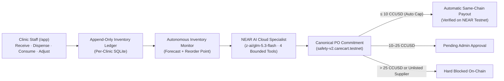

# CareCart

**Autonomous Clinic Inventory, Live NEAR AI Cloud Procurement Specialist & Policy-Guarded NEAR Testnet Payments**

CareCart is an autonomous medical inventory and procurement system built on **NEAR Testnet** and **NEAR AI Cloud (`z-ai/glm-5.3-flash`)**. Clinic staff record stock movements in an append-only ledger; an independent background monitor detects shortages, evaluates allowlisted supplier quotes, drafts canonical purchase orders, and hands off to a bounded NEAR AI Cloud procurement specialist and a Rust on-chain safety vault (`safety-v2.carecart.testnet`).

> **Scope:** CareCart operates exclusively on **NEAR Testnet** using the six-decimal **`CCUSD`** test token (`token-v2.carecart.testnet`) and live **NEAR AI Cloud** tool-calling inference (`https://cloud-api.near.ai/v1`).

---

## Architecture Overview



| Domain | Implementation | Responsibility |
|---|---|---|
| **Inventory** | [`backend/src/inventory`](backend/src/inventory) | Append-only stock ledger (units/packs, receipts, dispensing, direct consumption, reasoned adjustments, batch/expiry tracking) and headless [`InventoryMonitor`](backend/src/inventory/monitor.ts) with lease-based crash recovery. |
| **Procurement** | [`backend/src/procurement`](backend/src/procurement) & [`backend/src/workflow`](backend/src/workflow) | Exact integer reorder forecasting (`reorderPoint + leadTimeDemand - inventoryPosition`), deterministic quote selection (`lowest-total-then-supplier-id-v1`), and durable replenishment cases. |
| **Live AI Specialist** | [`backend/src/operations/runs.ts`](backend/src/operations/runs.ts) & [`backend/src/agent/live.ts`](backend/src/agent/live.ts) | Live **NEAR AI Cloud** (`z-ai/glm-5.3-flash`) procurement specialist operating under a strict 4-turn tool budget (`get_inventory_forecast`, `prepare_replenishment_case`, `evaluate_supplier_quotes`, `explain_procurement_decision`, `get_required_human_actions`, `propose_next_action`). The AI cannot alter prices, select unapproved suppliers, or sign transactions. |
| **On-Chain Safety Vault** | [`contracts/carecart-safety-vault`](contracts/carecart-safety-vault/src/lib.rs) | Rust NEAR smart contract enforcing immutable PO commitments, supplier allowlists, pause-only guardian, treasury recovery, and six-decimal spending caps (**10 CCUSD auto / 25 CCUSD hard PO / 25 CCUSD daily / 5 CCUSD initial accepted deposit**). |
| **Identity & Multi-Tenancy** | [`backend/src/tenancy`](backend/src/tenancy) | Supabase SSR authentication, clinic-scoped RBAC (`Admin`, `InventoryManager`, `ProcurementReviewer`, `Viewer`), per-clinic isolated SQLite databases, and NEP-413 wallet ownership verification. |
| **Web Application** | [`web/src/app`](web/src/app) | Next.js 16 / React 19 interface with landing page (`/`) and authenticated clinic workspace (`/app`: Overview, Inventory, Replenishment, Suppliers, Payments, Activity, Settings). |

---

## Live NEAR Testnet Deployment

| Role / Contract | NEAR Testnet Account |
|---|---|
| **Safety Vault v2** | `safety-v2.carecart.testnet` |
| **Test Token (`CCUSD`, 6 decimals)** | `token-v2.carecart.testnet` |
| **Admin Controller** | `admin.carecart.testnet` |
| **Pause Guardian** | `guardian.carecart.testnet` |
| **Treasury Owner** | `treasury.carecart.testnet` |
| **Restricted PO Committer** | `committer-v2.carecart.testnet` |
| **Restricted Payment Requester** | `agent-v2.carecart.testnet` |
| **Allowlisted Testnet Suppliers** | `medsupply-a.carecart.testnet`, `medsupply-b.carecart.testnet`, `medsupply-c.carecart.testnet` |

---

## Quick Start & Verification

### Prerequisites
- **Node.js:** `v24.21.0` (`nvm use`)
- **Rust:** `1.93.0` with `wasm32-unknown-unknown` target

### 1. Configure Environment
Copy [`.env.example`](.env.example) to `.env` in the repository root and symlink `web/.env.local -> ../.env`:

```bash
cp .env.example .env
ln -sf ../.env web/.env.local
```

Key environment settings in `.env`:
- `CARECART_AI_MODE=near-ai-cloud`
- `NEAR_CLOUD_BASE_URL=https://cloud-api.near.ai/v1`
- `NEAR_CLOUD_MODEL=z-ai/glm-5.3-flash`
- `NEAR_CLOUD_API_KEY=<your-near-ai-cloud-key>`
- `CARECART_TESTNET_WORKSPACE_FILE=../profiles/testnet.demo.json`
- `CARECART_TESTNET_PAYMENTS_FILE=../profiles/testnet.payments.json`

### 2. Install & Run Automated Verification
```bash
nvm use
npm ci --prefix backend --no-audit --no-fund
npm ci --prefix web --no-audit --no-fund
bash scripts/verify-phase2.sh
```

Run individual test suites directly:
```bash
# Rust smart contract unit & sandbox tests
cargo test --manifest-path contracts/Cargo.toml --locked -p carecart-safety-vault

# Backend typecheck & Vitest suite
cd backend && npx tsc --noEmit && npx vitest run

# Web typecheck & node:test suite
cd web && npx tsc --noEmit && npm test
```

### 3. Run the Application Services
```bash
# 1. Start the multi-tenant operations & identity API (:3002)
cd backend && npx tsx src/tenancy/server.ts

# 2. Start the background autonomous inventory monitor worker
cd backend && npx tsx src/tenancy/worker.ts

# 3. Start the Next.js web application (:3000)
cd web && npm run dev
```
