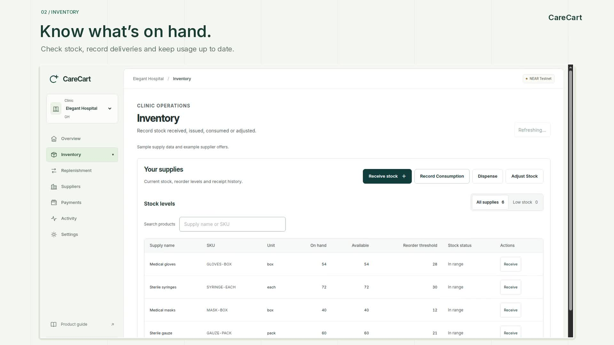
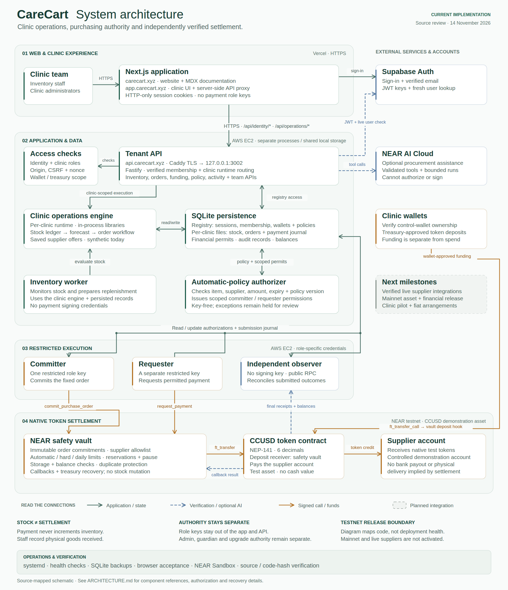

# CareCart

**Keep your clinic stocked.**

CareCart brings medical inventory, replenishment and purchasing into one clinic workspace. Teams record supplies received and used; background services identify shortages, prepare orders and coordinate payments within clinic-approved items, suppliers and spending limits.

[Open app](https://app.carecart.xyz) · [Watch the demo](https://x.com/0xelegant/status/2121579400017695050) · [Product docs](https://carecart.xyz/docs) · [Website](https://carecart.xyz)

[](https://x.com/0xelegant/status/2121579400017695050)

*The current workspace with demonstration clinic records. Watch the linked demo for inventory, orders, funding and purchasing controls.*

## What you can do

- **Manage inventory:** record deliveries, dispensing, consumption and adjustments, with batch and expiry tracking.
- **Replenish supplies:** monitor stock, compare saved supplier offers and prepare purchase orders.
- **Set purchasing authority:** choose eligible items, approved suppliers and an automatic spending limit. Qualifying orders can proceed without approval for each purchase; exceptions are held.
- **Follow payments:** view available and reserved balances, review funding, and track payments through independent confirmation.
- **Run the clinic workspace:** review activity, manage team access and configure clinic, monitoring and payment settings.

[](assets/architecture/carecart-architecture.svg)

[Explore the architecture](ARCHITECTURE.md) · [Open the scalable schematic](assets/architecture/carecart-architecture.svg)

NEAR’s policy vault enforces supplier checks, spending caps and pause controls. Separate workers commit orders and request permitted payments; an independent observer checks settlement. AI can assist with procurement proposals, while deterministic rules authorize spending. Staff record physical delivery separately from payment.

## Current release

The application runs on **NEAR testnet**, using **CCUSD**, a demonstration token with no cash value. CCUSD is not Circle USDC. Inventory examples and supplier offers are synthetic; the demonstrated supplier account is controlled for testing. Mainnet payments, live supplier integrations and clinic pilots are planned.

A recorded automatic-purchasing run demonstrated:

- Stock consumption creating a shortage and a 30-unit glove order.
- Automatic authorization under a bounded policy and a **1.5 CCUSD supplier payment**, without approval for that individual order.
- A repeated payment request producing **no additional transfer**.
- A separate goods receipt increasing stock once, independently of payment.

Inspect the [payment](https://testnet.nearblocks.io/txns/EsrPBQ9h7AZvASMBLkTDE1TZd1aMwvUF8HtyxfqrmbD), [duplicate request](https://testnet.nearblocks.io/txns/CHQWp7kA7veiBmryrRzBvHHE775n9A6XTdQLuSEACDGH) and [recorded evidence](docs/evidence/testnet/headless-sprint.json). The run used deterministic policy and did not include live AI inference. Its completed purchasing permission is disabled.

The published video tours the current workspace and shows a separate [recorded payment receipt](https://testnet.nearblocks.io/txns/Dfk9PUaGc6Gqc2533esgfB7zcG7kt3kSD5ixYuefQzvK). It shows purchasing controls with automation off, rather than executing a new payment. See the [judge walkthrough](docs/JUDGE_WALKTHROUGH.md) for reproduction steps, source verification and the boundaries of each demonstration.

## Try CareCart

Open [app.carecart.xyz](https://app.carecart.xyz), sign in and create a clinic workspace. Choose sample data during setup to explore the demonstration inventory. Product guides cover [inventory](https://carecart.xyz/docs/inventory-guide), [purchasing and payments](https://carecart.xyz/docs/purchasing-and-payments), and [safety and data](https://carecart.xyz/docs/safety-and-data).

Payment activation requires a configured treasury and verified purchasing authority. Mainnet funding is not open.

## Develop locally

### Requirements

- Node.js **24.21.0**, pinned in `.nvmrc`, and npm **12.2.1**.
- Rust **1.93.0**, pinned in `rust-toolchain.toml`, for contract development and tests.
- Chromium for the automated browser walkthrough.

### Install and start the website

```bash
git clone https://github.com/0xNana/carecart.git
cd carecart
nvm install
npm install --global npm@12.2.1
npm ci --prefix backend
npm ci --prefix web
npm run dev --prefix web
```

Open [localhost:3000](http://localhost:3000) for the website and MDX product documentation. The authenticated workspace also needs Supabase, the tenant API and runtime configuration. Follow [Contributing → Development setup](CONTRIBUTING.md#development-setup) for environment examples and service startup. The API development command is `npm run dev --prefix backend`.

### Local demonstration

Exercise the stock workflow without a Supabase account, wallet or public-chain transaction:

```bash
bash scripts/verify-phase2.sh --web-only
```

This runs frontend checks and creates an isolated production build. Use the output directory printed at completion in the browser walkthrough:

```bash
node scripts/mvp-browser-acceptance.mjs /tmp/carecart-phase2-verify.SNAPSHOT --headed
```

Replace `SNAPSHOT` with the printed suffix. The walkthrough starts its own services, records stock movements and verifies replenishment and separate receiving. Omit `--headed` for a headless run. Set `CARECART_CHROMIUM_BIN` if Chromium is installed outside `/snap/bin/chromium`. Screenshots and a JSON report are written to the printed output directory. This local fixture does not execute a public payment.

## Architecture

| Directory | Purpose |
| --- | --- |
| `web/` | Next.js application, Supabase sign-in and clinic interface. |
| `web/content/docs/` | Public MDX product documentation. |
| `backend/` | Fastify tenant API, SQLite records, stock monitoring and separate payment services. |
| `contracts/` | Rust NEAR contracts and local Sandbox tests. |
| `profiles/` | Runtime configuration examples. |
| `assets/architecture/` | Editable architecture schematic and rendered preview. |
| `scripts/` | Verification, browser walkthroughs, backups and deployment utilities. |
| `docs/evidence/` | Recorded testnet receipts, balance checks and source-verification results. |

See the [safety-vault README](contracts/carecart-safety-vault/README.md) for contract details and [EC2 deployment guide](backend/deploy/ec2/README.md) for backend service configuration.

## Validation

Run backend and frontend tests, type checks, lint and an isolated production web build:

```bash
bash scripts/verify-phase2.sh
```

Run the contract workspace tests:

```bash
cargo test --manifest-path contracts/Cargo.toml --locked --workspace
```

Individual checks and browser validation are documented in [Contributing](CONTRIBUTING.md#validation).

## Roadmap

The next milestones are a [first paying clinic](https://carecart.xyz/docs/first-paying-client), a bounded [inventory pilot](https://carecart.xyz/docs/clinic-pilot), and one verified [supplier integration](https://carecart.xyz/docs/supplier-integrations). Real-money purchasing follows the [mainnet readiness gates](https://carecart.xyz/docs/mainnet-readiness). See the [product roadmap](https://carecart.xyz/docs/product-roadmap) for the sequence and completion criteria.

## Hackathon disclosure

CareCart is one of two NEAR HACKATHON entries by elegant. The other is [Santa](https://github.com/0xNana/santa-on-near), a separate project for personal token gifts and sponsored claims on NEAR. CareCart focuses on clinic inventory and policy-controlled procurement; the projects have distinct product and contract workflows.

## Contributing

Bug reports, documentation improvements, usability fixes and integrations are welcome. Read [CONTRIBUTING.md](CONTRIBUTING.md) for setup, validation and pull-request guidance.

## License

[MIT](LICENSE). Third-party components retain their respective licenses, including the [Inter font license](web/public/fonts/Inter-LICENSE.txt).
