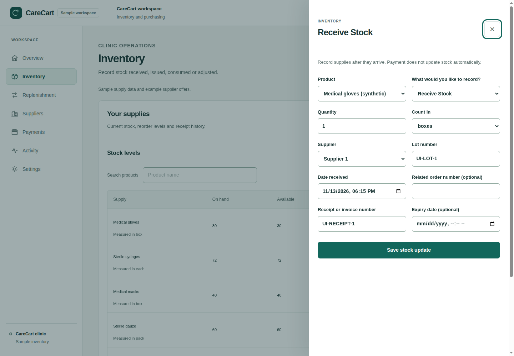

# CareCart

CareCart helps clinics keep reliable supply records and replenish essential items. Staff record stock received, consumed, dispensed or adjusted. A background monitor detects shortages, compares approved supplier offers and prepares a canonical purchase order. A deterministic financial policy can authorize eligible testnet purchases for separate restricted payment workers.


*Clinic overview with synthetic inventory and example supplier offers. [Explore CareCart](https://carecart.xyz) · [Read the product guides](https://carecart.xyz/docs) · [View the verified 1.5 CCUSD test payment](https://testnet.nearblocks.io/txns/EsrPBQ9h7AZvASMBLkTDE1TZd1aMwvUF8HtyxfqrmbD).*

CareCart manages inventory and procurement records; it does not make clinical decisions or provide medical advice.

> **Current scope:** A clinic administrator can select suppliers, items and an automatic order limit. Eligible testnet orders can proceed without a separate human signature for each order; other orders remain for review. A bounded synthetic-clinic run completed a genuine 1.5 CCUSD supplier payment on November 13. CCUSD has no cash value. Mainnet, Circle USDC, real clinic deployment and NEAR Intents settlement are outside this release.

## Hackathon project

CareCart is a testnet-first medical inventory and procurement project for the [NEAR Hackathon 2026](https://nearhackathon.com/HACKATHON.md). The project addresses stockouts and manual purchasing work in clinics. NEAR provides a programmable vault for supplier allowlists, payment roles, spending limits, pause controls and payment records.

The payment examples use CareCart demonstration tokens such as **CCUSD**. They are test assets with no cash value and are not Circle USDC. This submission does not claim a completed NEAR Intents settlement.

### Hackathon contribution and attribution

The available Git history begins on November 1, 2026. Relevant commits in that history include:

- `79c04e3` — guarded CareCart vault payments
- `b38b2be` — NEP-141 vault tests in NEAR Sandbox
- `54fbdd5` — add the repository metadata needed for a pinned reproducible safety-vault build
- `03b073b`, `af14a45`, `65cf766` — procurement data, inventory forecasting, supplier offers and purchase orders
- `d801c1e` — constrained agent tools
- `bbefbe1` — vault safety and treasury recovery
- `e9978a6` — procurement dashboard and reviewed testnet wallet actions
- `45c0fd3` — payment-account deposit flow

This describes the history present in this repository. It cannot establish whether CareCart or related product work existed outside this Git history before November 1. The owner should add any known earlier work and attribution before submission.

The project uses Next.js, React, Fumadocs/MDX, TypeScript, `near-api-js`, `@hot-labs/near-connect`, Rust `near-sdk`, SQLite and local NEAR Sandbox tests. Versions are pinned in the package manifests and lockfiles. The available repository history does not identify an external starter template; add any separately used templates, copied components or third-party work that is not represented there.

## How it works

```mermaid
flowchart LR
  A[Clinic staff record stock activity] --> B[Clinic inventory ledger]
  B --> C[Background stock monitor]
  C --> D[Shortage case and supplier-offer comparison]
  D --> E[Prepared purchase order]
  E --> F[Clinic standing policy or explicit order authorization]
  F --> G[Role-limited payment worker]
  G --> H[NEAR safety vault]
  H --> I[Onchain limits and CCUSD transfer]
  I --> J[Independent payment observation and audit record]
  J --> K[Staff record physical delivery]
  K --> B
```



The inventory worker is key-free and prepares replenishment work. A separate internal evaluator can issue operation-specific authorizations from a clinic standing policy. Separate restricted payment services consume those authorizations; the safety vault checks the saved order, approved supplier, payment limits and pause state. A recorded transaction submission is not treated as payment success until the configured observer verifies it. Staff record physical delivery separately from payment.



*Stock-receiving side panel captured during the local browser walkthrough. Physical deliveries are recorded separately from payments; this isolated demo does not send payments.*

## Repository layout

| Path | Contents |
| --- | --- |
| `web/` | Clinic workspace and public product pages. |
| `backend/` | TypeScript API, tenant services, inventory monitor and restricted payment services. |
| `contracts/carecart-safety-vault/` | NEAR contract with supplier and spending controls. |
| `contracts/` | Contract workspace and local test-token fixtures. |
| `profiles/` | Example runtime profiles. They are configuration, not proof of live account state. |
| `scripts/` | Verification, isolated demo, build and deployment utilities. |
| `web/content/docs/` | Public MDX product guides, mainnet readiness, clinic pilot, first-customer plan and supplier integrations, served at [carecart.xyz/docs](https://carecart.xyz/docs). |
| `docs/` | Public [judge walkthrough](docs/JUDGE_WALKTHROUGH.md) and recorded verification evidence. Internal release notes are kept locally and ignored. |

## Quick start: offline demo

The reproducible demo uses synthetic clinic data and local services. It does not require Supabase, an AI API key, a wallet, testnet funds or a public network transaction.

### Prerequisites

- Node.js **24.21.0**, selected by `.nvmrc`.
- npm **12.2.1**, declared by the web and backend packages. If needed, install it after selecting Node with `npm install --global npm@12.2.1`.
- Rust **1.93.0** with `wasm32-unknown-unknown` for contract checks.
- Chromium for the browser walkthrough. Set `CARECART_CHROMIUM_BIN` if Chromium is installed somewhere other than `/snap/bin/chromium`.

### Install and verify

From the repository root:

```bash
nvm use
npm ci --prefix backend
npm ci --prefix web
bash scripts/verify-phase2.sh
```

Expected result: all backend and web tests, TypeScript checks, lint and the isolated production build exit successfully. The script prints the location of its source-only verification snapshot under `/tmp/carecart-phase2-verify.*`.

### Run the judge walkthrough

Pass the snapshot path printed by the previous command:

```bash
node scripts/mvp-browser-acceptance.mjs /tmp/carecart-phase2-verify.REPLACE_WITH_PRINTED_SUFFIX
```

Expected result: the final JSON report contains `"status": "passed"`, stock movements, a background-created purchase order, one recorded delivery, a successful worker restart, no browser errors, no payment actions and no public-chain calls. Screenshot files are saved in the temporary output directory named in the report. Replace the example suffix with the exact path printed by the verifier.

The walkthrough starts an isolated local API, web app and inventory worker using synthetic data. It records a receipt, dispensing, consumption and adjustment; lets the worker detect a shortage and prepare an order; records delivery once; restarts the worker; and checks that the order is not duplicated. The payment state remains **Unobserved** because this demo does not send a payment.

For a screen recording, start your screen recorder and run the same flow in a visible Chromium window:

```bash
node scripts/mvp-browser-acceptance.mjs /tmp/carecart-phase2-verify.REPLACE_WITH_PRINTED_SUFFIX --headed
```

Replace the snapshot suffix with the verifier's exact output. The visible mode pauses at each main step for about seven seconds; set `CARECART_DEMO_PAUSE_MS` to a value from 2,000 to 15,000 milliseconds if you need more narration time. It still uses synthetic local data, and payment stays **Unobserved**. See the [judge walkthrough](docs/JUDGE_WALKTHROUGH.md) for the 90–150-second narration outline.

See [`docs/JUDGE_WALKTHROUGH.md`](docs/JUDGE_WALKTHROUGH.md) for expected steps and troubleshooting.

## Authenticated clinic workspace

The authenticated app requires a Supabase project. Copy `.env.example` to `.env`, set the Supabase URL and publishable key, and link it for Next.js:

```bash
cp .env.example .env
ln -s ../.env web/.env.local
```

Keep real credentials in local environment files. Do not put signing keys in the shared `.env`; the API, inventory worker and web server refuse those keys. Payment signing belongs in protected, role-specific environments with only the key required by that service.

The testnet profile files require database paths under the active checkout. Before using them from another clone or host, update each profile's `databasePath` to that checkout's absolute `backend/data/testnet-v2/...` path; the payment profile's `fingerprintDatabasePath` preserves its reviewed identity across that relocation. The offline judge walkthrough does not read either profile or require these service settings.

The local synthetic walkthrough above is the recommended judge path when hosted identity credentials are unavailable.

## NEAR integration and evidence limits

The reviewed Rust source at `52060a1626c02f9d8b93538110715f01937e31cb` rebuilt with Rust 1.93.0 and cargo-near 0.22.0 produces SHA-256 `979c178881f12ce6694ea804d9374af3606b55dbb0b8074434e791d5c9b0b71e`, encoded by NEAR as `BCpcRunpuzhjrshyq1yrKtsmABrAAPy6ZFmMrUvUUqK3`. Read-only RPC retrieval of the deployed WASM matched those exact bytes. Current vault Rust source and Cargo.lock match that revision; the later package-metadata/container build is a different artifact, not an unknown deployment. See [source evidence](docs/evidence/testnet/vault-source-verification.json) and `bash scripts/reproduce-deployed-vault.sh`.

The November 13 headless run consumed synthetic gloves, generated a 30-unit PO and automatically authorized both restricted roles from the owner's preapproved one-order policy. It paid **1.5 CCUSD (1,500,000 base units)** to `medsupply-a.carecart.testnet`:

- [Commitment](https://testnet.nearblocks.io/txns/GkenNfSpQq7YeXfUS6fH5rHhEHKo3kkwV3VbAPtwMK9F)
- [Confirmed supplier payment](https://testnet.nearblocks.io/txns/EsrPBQ9h7AZvASMBLkTDE1TZd1aMwvUF8HtyxfqrmbD)
- [Duplicate request: zero additional transfer](https://testnet.nearblocks.io/txns/CHQWp7kA7veiBmryrRzBvHHE775n9A6XTdQLuSEACDGH)
- [Independent public receipt and balance evidence](docs/evidence/testnet/autonomous-payment.json)
- [Headless policy and inventory trace](docs/evidence/testnet/headless-sprint.json)

Historical block queries show the supplier increasing from 1,500,000 to 3,000,000 base units and the vault decreasing from 3,500,000 to 2,000,000. The duplicate request left the supplier at 3,000,000. Inventory stayed at 26 after payment and increased to 56 only on the separately recorded synthetic delivery. Replaying the delivery added zero units. The one-order policy was then disabled.

Verify the public payment from a clean checkout; no private clinic database, API key or signer is needed:

```bash
nvm use
npm ci --prefix backend
node --import ./backend/node_modules/tsx/dist/loader.mjs backend/src/ops/testnet-payment-evidence.ts \
  profiles/testnet.payments.json docs/evidence/testnet/autonomous-payment.json
```

The output must confirm `nativeSettlementVerified: true` and `deltaVerified: true`. The supplier is a controlled test account, not an integrated real medical distributor. A separate November 10 payment was also independently recovered and verified in [historical evidence](docs/evidence/testnet/supplier-payment.json).

Normal automatic policies require a current clinic administrator and verified clinic control wallet; they bind selected items/suppliers, an amount at or below 10 CCUSD, the active treasury, and an expiry of at most 24 hours. The sprint used an explicitly approved host control-plane grant restricted to exactly one synthetic glove PO and at most 3 CCUSD. Both use the same permits, journals, workers and onchain policy. The LLM has no financial authorization or signing tool. See the public [safety and authority guide](https://carecart.xyz/docs/safety-and-data).

The unchanged vault policy enforces a 10 CCUSD automatic threshold, 25 CCUSD hard order and daily dispatch caps, and a 5 CCUSD initial accepted deposit ceiling. Above-threshold orders require human review; public tenant admin-wallet handoff is still disabled, so those orders remain held in the current app. Local Sandbox verifies valid human approval and hard-cap enforcement. A vault-account full-access upgrade key remains an owner authority capable of replacing contract code; limits depend on retaining the reviewed deployment. This is disclosed, not a claim of an immutable deployment.

No mainnet transaction or NEAR Intents settlement was performed. NEAR Intents is a separate future integration.

## Verification

Run the complete backend and web verification workflow:

```bash
bash scripts/verify-phase2.sh
```

Run the contract workspace tests, including local NEAR Sandbox tests:

```bash
cargo test --manifest-path contracts/Cargo.toml --locked --workspace
```

Build the safety vault for WebAssembly:

```bash
cargo check --target wasm32-unknown-unknown --manifest-path contracts/Cargo.toml --workspace --locked
```

The safety-vault manifest also records the pinned Docker image for a reproducible Wasm build. The build output includes source metadata and is tied to the source commit. For the exact historical artifact hash and its comparison with the deployed testnet code, see the [source verification evidence](docs/evidence/testnet/vault-source-verification.json) and `bash scripts/reproduce-deployed-vault.sh`.

The Sandbox tests use local synthetic accounts and token fixtures. They do not sign public transactions, deploy contracts or move real funds. See the contract READMEs for contract-specific commands and scope.

## Security

- Never commit `.env` files, private keys, account credentials, real clinic databases or customer records.
- Local environment files, database files, build output, `internal-docs/`, `tasks/` and internal notes in `docs/` are ignored by Git. The public walkthrough, verification evidence and MDX product guides remain tracked.
- Public testnet configuration is not a production deployment or proof of payment.
- Recorded implementation checks are in [verification evidence](docs/evidence/verification.json). Production release requirements are described in the [mainnet readiness guide](https://carecart.xyz/docs/mainnet-readiness).

CareCart is provided under the [MIT License](LICENSE).
