# CareCart

CareCart helps clinics keep reliable supply records and replenish essential items. Staff record stock received, consumed, dispensed or adjusted. A background monitor can detect shortages, compare approved supplier offers and prepare a purchase order.

CareCart manages inventory and procurement records; it does not make clinical decisions or provide medical advice.

> **Current scope:** Inventory monitoring and purchase-order preparation can run automatically. The current clinic workflow still requires a person to authorize each order and payment request. The NEAR safety vault can enforce its configured supplier and spending policy, but this release does not demonstrate unattended end-to-end purchasing.

## Hackathon project

CareCart is a testnet-first medical inventory and procurement project for the [NEAR Hackathon 2026](https://nearhackathon.com/HACKATHON.md). The project addresses stockouts and manual purchasing work in clinics. NEAR provides a programmable vault for supplier allowlists, payment roles, spending limits, pause controls and payment records.

The payment examples use CareCart demonstration tokens such as **CCUSD**. They are test assets with no cash value and are not Circle USDC. This submission does not claim a completed NEAR Intents settlement.

### Hackathon contribution and attribution

The available Git history begins on November 1, 2026. Relevant commits in that history include:

- `79c04e3` — guarded CareCart vault payments
- `b38b2be` — NEP-141 vault tests in NEAR Sandbox
- `03b073b`, `af14a45`, `65cf766` — procurement data, inventory forecasting, supplier offers and purchase orders
- `d801c1e` — constrained agent tools
- `bbefbe1` — vault safety and treasury recovery
- `e9978a6` — procurement dashboard and reviewed testnet wallet actions
- `45c0fd3` — payment-account deposit flow

This describes the history present in this repository. It cannot establish whether CareCart or related product work existed outside this Git history before November 1. The owner should add any known earlier work and attribution before submission.

The project uses Next.js, React, TypeScript, `near-api-js`, `@hot-labs/near-connect`, Rust `near-sdk`, SQLite and local NEAR Sandbox tests. Versions are pinned in the package manifests and lockfiles. The available repository history does not identify an external starter template; add any separately used templates, copied components or third-party work that is not represented there.

## How it works

```mermaid
flowchart LR
  A[Clinic staff record stock activity] --> B[Clinic inventory ledger]
  B --> C[Background stock monitor]
  C --> D[Shortage case and supplier-offer comparison]
  D --> E[Prepared purchase order]
  E --> F[Clinic approval for this order and payment]
  F --> G[Role-limited payment worker]
  G --> H[NEAR safety vault]
  H --> I[Policy checks and test-token transfer]
  I --> J[Independent payment observation and audit record]
  J --> K[Staff record physical delivery]
  K --> B
```



The inventory worker can monitor stock and prepare replenishment work. It is not authorized to spend funds. Restricted payment services process an order only after the required clinic authorization; the safety vault checks the saved order, approved supplier, payment limits and pause state. A recorded transaction submission is not treated as payment success until the configured observer verifies it. Staff record physical delivery separately from payment.

## Repository layout

| Path | Contents |
| --- | --- |
| `web/` | Clinic workspace and public product pages. |
| `backend/` | TypeScript API, tenant services, inventory monitor and restricted payment services. |
| `contracts/carecart-safety-vault/` | NEAR contract with supplier and spending controls. |
| `contracts/` | Contract workspace and local test-token fixtures. |
| `profiles/` | Example runtime profiles. They are configuration, not proof of live account state. |
| `scripts/` | Verification, isolated demo, build and deployment utilities. |
| `docs/` | Judge walkthrough and submission handoff. |

## Quick start: offline demo

The reproducible demo uses synthetic clinic data and local services. It does not require Supabase, an AI API key, a wallet, testnet funds or a public network transaction.

### Prerequisites

- Node.js **24.21.0**, selected by `.nvmrc`.
- npm **12.2.1**, declared by the web and backend packages. If needed, install it after selecting Node with `npm install --global npm@12.2.1`.
- Rust **1.93.0** with `wasm32-unknown-unknown` for contract checks.
- Chromium for the browser walkthrough. Set `CARECART_CHROMIUM_BIN` if Chromium is installed somewhere other than `/snap/bin/chromium`.

### Install and verify

From the repository root:

```bash
nvm use
npm ci --prefix backend
npm ci --prefix web
bash scripts/verify-phase2.sh
```

Expected result: all backend and web tests, TypeScript checks, lint and the isolated production build exit successfully. The script prints the location of its source-only verification snapshot under `/tmp/carecart-phase2-verify.*`.

### Run the judge walkthrough

Pass the snapshot path printed by the previous command:

```bash
node scripts/mvp-browser-acceptance.mjs /tmp/carecart-phase2-verify.REPLACE_WITH_PRINTED_SUFFIX
```

Expected result: the final JSON report contains `"status": "passed"`, stock movements, a background-created purchase order, one recorded delivery, a successful worker restart, no browser errors, no payment actions and no public-chain calls. Screenshot files are saved in the temporary output directory named in the report. Replace the example suffix with the exact path printed by the verifier.

The walkthrough starts an isolated local API, web app and inventory worker using synthetic data. It records a receipt, dispensing, consumption and adjustment; lets the worker detect a shortage and prepare an order; records delivery once; restarts the worker; and checks that the order is not duplicated. The payment state remains **Unobserved** because this demo does not send a payment.

See [`docs/JUDGE_WALKTHROUGH.md`](docs/JUDGE_WALKTHROUGH.md) for expected steps and troubleshooting.

## Authenticated clinic workspace

The authenticated app requires a Supabase project. Copy `.env.example` to `.env`, set the Supabase URL and publishable key, and link it for Next.js:

```bash
cp .env.example .env
ln -s ../.env web/.env.local
```

Keep real credentials in local environment files. Do not put signing keys in the shared `.env`; the API, inventory worker and web server refuse those keys. Payment signing belongs in protected, role-specific environments with only the key required by that service.

The testnet profile files require database paths under the active checkout. Before using them from another clone or host, update each profile's `databasePath` to that checkout's absolute `backend/data/testnet-v2/...` path; the payment profile's `fingerprintDatabasePath` preserves its reviewed identity across that relocation. The offline judge walkthrough does not read either profile or require these service settings.

The local synthetic walkthrough above is the recommended judge path when hosted identity credentials are unavailable.

## NEAR integration and evidence limits

The safety vault is designed to enforce an allowlisted supplier, separate roles, a per-order automatic limit, a hard payout limit, a daily limit and a pause control. The application still requires per-order clinic authorization before payment processing, so the presence of a capped contract path does not prove autonomous purchasing.

At `2026-11-13T06:48:08Z`, read-only RPC checks at finalized block `EKi9urzVA9Af64i8LTcwPBQFdrrpQukcjQ6D2wsH148T` (height `277475353`) found that `safety-v2.carecart.testnet` and `token-v2.carecart.testnet` matched the code hashes in `profiles/testnet.payments.json`. The token's on-chain metadata reported `CCUSD`, six decimals and `ft-1.0.0`. This verifies deployed code and token metadata only; it does not demonstrate role setup, spendable balance, a supplier payment or payment observation. The separate `profiles/testnet.demo.json` is an offline proposal profile tied to the checked-in artifact hashes, not evidence for the deployed contracts. A source review also found that fresh Wasm builds were not byte-identical across the recorded environments; this submission does not claim reproducible byte-for-byte contract artifacts. No verified public supplier-payment receipt is attached to this release. Do not present local fixtures or Sandbox runs as public testnet transactions. Do not describe CCUSD as native Circle USDC.

The repository includes cross-chain and NEAR Intents related code, but the current product does not demonstrate a completed public Intents settlement. Do not use an offline preview or test fixture as settlement evidence.

## Verification

Run the complete backend and web verification workflow:

```bash
bash scripts/verify-phase2.sh
```

Run the contract workspace tests, including local NEAR Sandbox tests:

```bash
cargo test --manifest-path contracts/Cargo.toml --locked --workspace
```

Build the safety vault for WebAssembly:

```bash
cargo check --target wasm32-unknown-unknown --manifest-path contracts/Cargo.toml --workspace --locked
```

The Sandbox tests use local synthetic accounts and token fixtures. They do not sign public transactions, deploy contracts or move real funds. See the contract READMEs for contract-specific commands and scope.

## Security

- Never commit `.env` files, private keys, account credentials, real clinic databases or customer records.
- Local environment files, database files, build output and `internal-docs/` are ignored by Git.
- Public testnet configuration is not a production deployment or proof of payment.
- The current submission handoff records the checks actually run and the remaining owner actions: [`docs/SUBMISSION_HANDOFF.md`](docs/SUBMISSION_HANDOFF.md).

CareCart is provided under the [MIT License](LICENSE).
