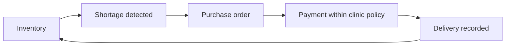

# CareCart

**Autonomous medical inventory and procurement for clinics.**

CareCart helps clinic teams track supplies, spot shortages and replenish stock. Staff record deliveries and usage while background services prepare purchase orders and coordinate payments within the clinic’s approved budget and supplier rules.

[Website](https://carecart.xyz) · [Open app](https://app.carecart.xyz) · [Documentation](https://carecart.xyz/docs) · [Contributing](CONTRIBUTING.md)


*The working application with sample clinic data.*

## Features

- **Inventory management:** record receipts, dispensing, consumption and adjustments, with batch and expiry tracking.
- **Automatic replenishment:** monitor stock levels, compare supplier offers and prepare purchase orders.
- **Controlled purchasing:** configure approved items, suppliers and spending limits. Eligible orders can proceed automatically; exceptions remain for review.
- **Payment tracking:** follow payments from preparation through submission and independent confirmation.
- **Clinic workspaces:** manage staff access and review stock, order and payment history.

## How it works



The NEAR policy vault enforces supplier checks, spending caps and pause controls. A submitted transaction is confirmed only after independent verification. Staff record physical deliveries separately so payment status never changes stock quantities automatically.

## Current release

CareCart runs on **NEAR testnet** using **CCUSD**, a demonstration token with no cash value. CCUSD is not Circle USDC. Supplier offers and clinic examples use sample data; real supplier integrations, clinic pilots and mainnet payments are planned.

A recorded testnet demonstration completed a **1.5 CCUSD supplier payment** to a controlled test account. See the [transaction](https://testnet.nearblocks.io/txns/EsrPBQ9h7AZvASMBLkTDE1TZd1aMwvUF8HtyxfqrmbD) and [verification record](docs/evidence/testnet/autonomous-payment.json).

Read the [product roadmap](https://carecart.xyz/docs/product-roadmap), [pilot plan](https://carecart.xyz/docs/clinic-pilot) and [mainnet readiness guide](https://carecart.xyz/docs/mainnet-readiness).

## Getting started

### Requirements

- Node.js **24.21.0** and npm **12.2.1**.
- Rust **1.93.0** for smart-contract development and tests.
- Chromium for the browser walkthrough.

### Installation

```bash
git clone https://github.com/0xNana/carecart.git
cd carecart
nvm use
npm ci --prefix backend
npm ci --prefix web
```

The repository includes Node and Rust version files. If needed, install the pinned npm version with `npm install --global npm@12.2.1`.

### Web development

```bash
npm run dev --prefix web
```

Open [localhost:3000](http://localhost:3000) to view the website and product documentation. The signed-in clinic workspace also requires the backend and authentication configuration; see [Contributing](CONTRIBUTING.md#development-setup).

### Local demonstration

The automated walkthrough runs the clinic workspace with sample data and local services. It covers stock movements, shortage detection, order preparation and delivery recording without a Supabase account, wallet or public-chain transaction.

```bash
bash scripts/verify-phase2.sh --web-only
```

The command checks the frontend and creates a production build in a temporary directory. Replace `SNAPSHOT` below with the suffix printed at completion:

```bash
node scripts/mvp-browser-acceptance.mjs /tmp/carecart-phase2-verify.SNAPSHOT --headed
```

For a headless run, omit `--headed`. If Chromium is installed outside `/snap/bin/chromium`, set `CARECART_CHROMIUM_BIN` to its executable path. Screenshots and a JSON report are saved in the output directory printed by the walkthrough.

## Project structure

| Directory | Description |
| --- | --- |
| `web/` | Next.js frontend, clinic workspace and product documentation. |
| `backend/` | Fastify API, SQLite storage, inventory monitoring and payment services. |
| `contracts/` | Rust smart contracts and local NEAR Sandbox tests. |
| `profiles/` | Runtime configuration examples. |
| `scripts/` | Development, build, verification and deployment utilities. |
| `web/content/docs/` | Public MDX product guides. |
| `docs/evidence/` | Recorded testnet payment and verification results. |

## Testing

Run backend and frontend tests, type checks, lint and the production web build:

```bash
bash scripts/verify-phase2.sh
```

Run the contract workspace tests:

```bash
cargo test --manifest-path contracts/Cargo.toml --locked --workspace
```

See [Contributing](CONTRIBUTING.md#validation) for individual checks and the [safety-vault documentation](contracts/carecart-safety-vault/README.md) for contract build instructions.

## Contributing

Bug reports, documentation improvements and code contributions are welcome. Read [CONTRIBUTING.md](CONTRIBUTING.md) for development setup, testing and pull-request guidelines.

## License

CareCart is licensed under the [MIT License](LICENSE). Third-party components retain their respective licenses, including the [Inter font license](web/public/fonts/Inter-LICENSE.txt).
