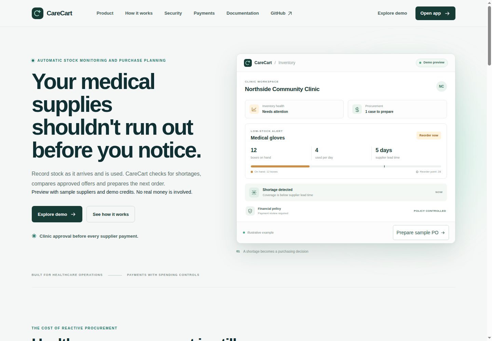
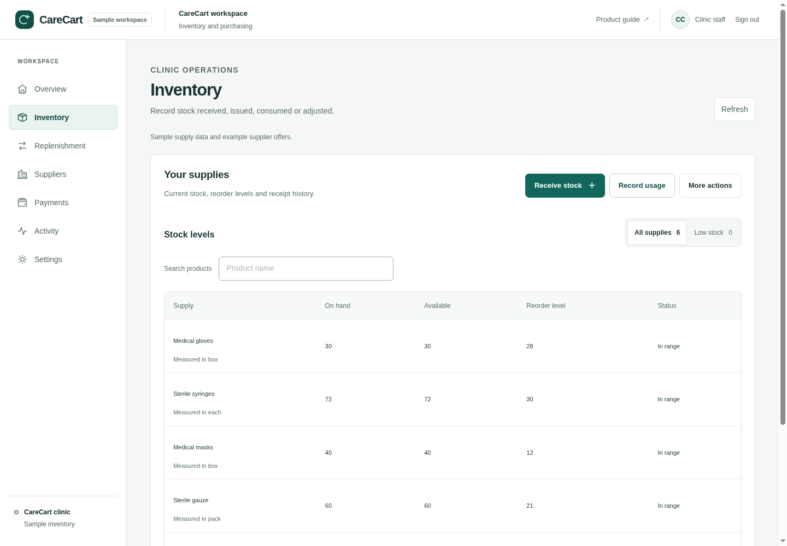
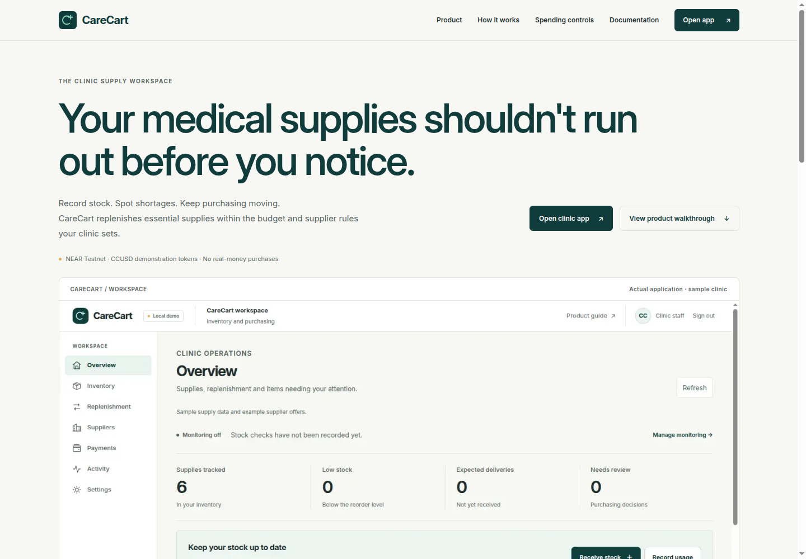
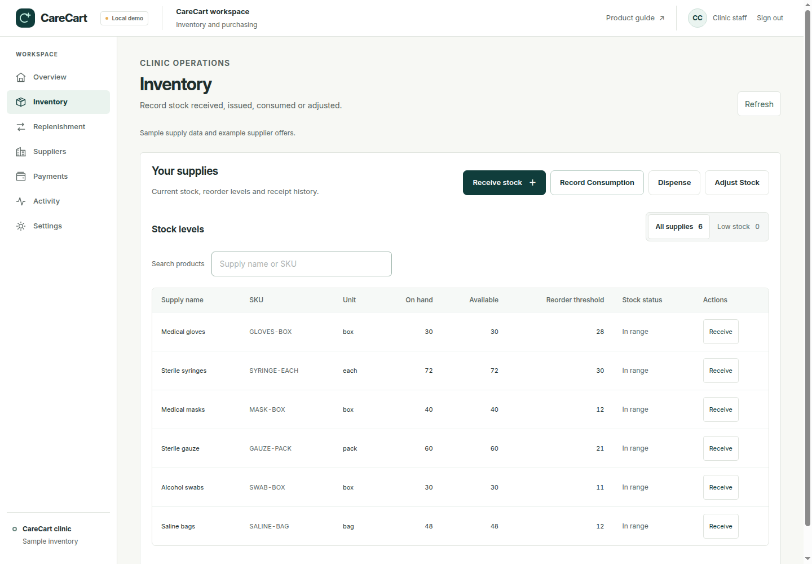
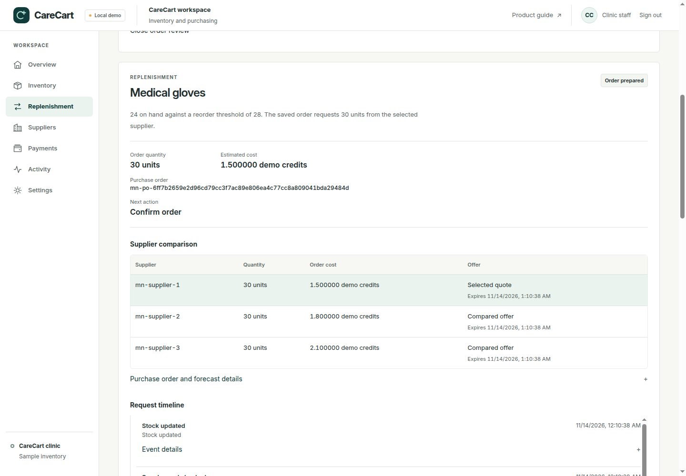
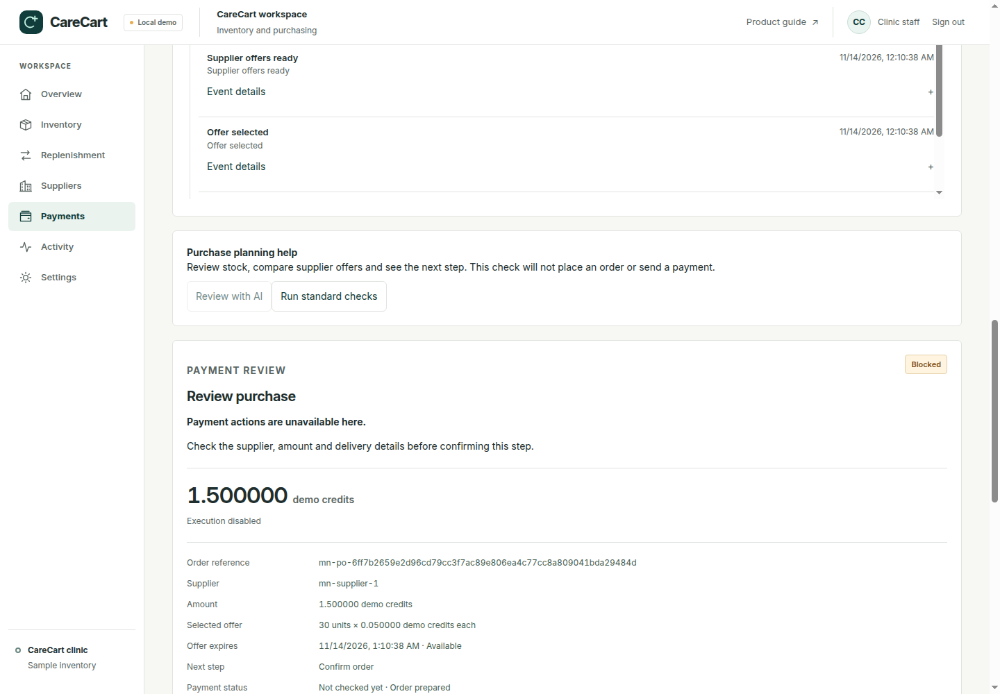

# CareCart design review

Review begun November 13 and finalized November 14, 2026. Scope: presentation, copy and existing interface interactions. Inventory accounting, backend routes, authentication, policy authorization, workers, signing and transaction observation remain unchanged.

## Design contract

CareCart is a clinic operations workspace. Each screen should make the current state and next action easy to find. Use the existing deep teal `#103D3B`, warm off-white `#F7F8F4`, mint `#8EDCC0` and amber `#E9AE55`. Inter is self-hosted under its included open font license. Neutral text and borders carry most of the interface; color signals actionable exceptions. Use shared spacing, radius, focus, surface, typography and status tokens. Keep quantities aligned with tabular numerals. Tables scroll inside their own region on narrow screens.

The primary stock action is Receive Stock. Dispense, Record Consumption and Adjust Stock remain visible. Forms retain their existing requirements, request identifiers and submission guards. Replenishment presents saved order context before payment actions. A submitted transaction never becomes a confirmed payment merely because a journal entry completed.

## References studied and access limits

These references informed structure, not branding or assets:

- [Attio table views](https://attio.com/help/reference/managing-your-data/views/create-and-manage-table-views): inspected the rendered help interface and the embedded product table. Column alignment, named records and a stable view toolbar informed the stock table and read-only order comparison. CareCart keeps row actions visible rather than relying on hover controls.
- [Linear](https://linear.app): inspected the rendered compact navigation; the animated product content did not render reliably in the isolated browser. The attempted issue-view documentation route also failed to render. No authenticated Linear workflow is claimed as tested.
- [Ramp accounts payable](https://ramp.com/accounts-payable): inspected the rendered hierarchy and primary/secondary actions. The public product media was partially loaded; an authenticated payment workflow was unavailable.
- [Mercury public demo](https://demo.mercury.com): attempted twice; it remained on its loading indicator. No Mercury interaction observations are invented.
- [Sortly features](https://www.sortly.com/features/): inspected the rendered task-oriented inventory presentation. The public page showed feature illustrations rather than an authenticated inventory table.

Reference screenshots remain local research artifacts, not CareCart product assets. Only CareCart's own synthetic application screenshots are published here.

The deployed CareCart landing page was captured at 1440, 768 and 390 pixels before implementation. All seven authenticated application routes were captured using the same production build and an isolated local authentication fixture. Hosted authenticated sessions were unavailable in this chat. Local screenshots are explicitly sample data; they do not demonstrate a new hosted login or real supplier payment.

## Five consequential problems and changes

| Original problem | Implemented change |
| --- | --- |
| Repeated landing sections and invented dashboard mockups obscured the working product. Copy incorrectly required approval for every payment. | An editorial hero and readable actual app screenshot lead to a single Inventory → Shortage → Purchase order → Payment → Delivery story. The focused vault section explains budgeted autonomy and held exceptions. CCUSD, testnet and real-supplier limitations are explicit. |
| Competing greens, hardcoded typography, rounded surfaces and inconsistent spacing made screens feel unrelated. | Shared semantic tokens, self-hosted Inter, a narrower sidebar, compact header, restrained active state, reduced shadows and a compact production NEAR Testnet indicator. The local fixture says Local demo. |
| The stock table omitted SKU and unit columns. “More actions” immediately opened dispensing. | A compact supply/SKU/unit/on-hand/available/reorder/status/actions table, right-aligned numeric columns, working name/SKU search, low-stock filter and visible named stock actions. Row receiving selects the corresponding supply. |
| Forecast, supplier choice and timeline were hidden below financial controls. | A read-only replenishment record shows persisted stock need, saved quantity and estimate, supplier comparison, selected quote, purchase order, next action and recent timeline. Event references remain expandable. |
| Payment state, network and independent transfer evidence were hard to inspect. | A payment review summary shows amount/token, environment, approval, policy outcome, verified payment status, transaction identifier and explorer link. Its presentation helper distinguishes Prepared, Awaiting approval, Authorized, Submitted, Confirmed, Blocked, Failed and Checking status. Confirmed requires a matching independently verified public testnet transfer. |

No new purchasing capabilities or supplier integrations were introduced. Existing authorization checkboxes, wallet binding requirements, disabled states and role checks remain in place.

## Screenshots

All application screenshots use synthetic clinic data. Payment review screenshots, where present, show the local execution boundary rather than a fabricated successful payment.

### Before





### After









Mobile captures: [landing](../web/public/screenshots/design-review/after-home-390.png), [inventory](../web/public/screenshots/design-review/after-inventory-390.png), [order detail](../web/public/screenshots/design-review/after-order-390.png). All seven application routes were also captured at 768 pixels by the reproducible browser runner.

The final browser report recorded 35 application viewport checks, 12 public navigation/reload checks and six order/payment detail checks. All passed, including the long order-reference label check. Hosted authenticated routes remain an owner-session verification item.

## Verification

The owner-run reproduction command is:

```bash
nvm use
bash scripts/verify-phase2.sh --web-only
node scripts/mvp-browser-acceptance.mjs /tmp/carecart-phase2-verify.REPLACE_WITH_PRINTED_SUFFIX
```

Use the exact snapshot directory printed by the verifier. For the backend regression suite, run `node node_modules/vitest/vitest.mjs run --maxWorkers=1` inside that snapshot’s `backend/` directory. The browser command saves screenshots and `browser-report.json` in the temporary output directory named in its report. It covers all seven authenticated sections, public pages, desktop/tablet/mobile sizes, stock workflows, worker-created purchase orders and restart idempotency. It uses synthetic local data and has no public-chain or signing actions.

Verified results:

- **486 backend tests across 74 files passed**, including restricted payment roles, independent observation, standing-policy purchasing, duplicate requests and tenant isolation. The suite ran with one worker in the secret-free source snapshot. Two payment tests hit their existing five-second limits while the initial two-worker run competed with a production build; the serial rerun passed without changing assertions or timeouts.
- **80 web tests passed**, including new payment-presentation regressions that reject missing receipt proof, mismatched amount/token/recipient/order/network, mock/Sandbox provenance and cross-chain destinations as public native confirmation.
- Frontend and backend TypeScript checks passed. Lint has no errors and retains two pre-existing navigation warnings. The default Turbopack production build passed.
- The complete Chromium walkthrough passed: seven authenticated sections at 1440/1024/768/390/320 pixels; public landing/docs navigation and hard reloads at 1440/768/390; real synthetic receiving/consumption/dispensing/adjustment; worker-created order; physical receipt and restart idempotency. No browser runtime errors or console errors.
- Additional browser checks verify invalid quantities, duplicate-click idempotency, modal Tab containment, Escape dismissal, focus restoration, row receiving for the chosen supply, responsive supplier comparisons and no false payment confirmation. The final capture also guards readable long purchase-order labels.
- The financial and stock mutation payload blocks were compared against the starting revision and remain byte-for-byte unchanged. No backend, contract or payment-profile source was changed. All browser payment/signing/public-submission spies remain zero.
- Core text contrast ratios against white: primary 14.09:1, muted 6.06:1, teal 11.98:1 and amber text 6.82:1. These token checks supplement the browser inspection; they are not a full WCAG certification.
- Source/history credential scan passed with zero findings before publication.

Changed file groups:

| Files | Purpose |
| --- | --- |
| `web/src/app/globals.css`, `web/src/app/layout.tsx` | Shared tokens, self-hosted typography and accurate metadata. |
| `web/src/components/landing-page.tsx`, `landing-page.module.css` | Editorial product site and actual application imagery. |
| `web/src/components/application-shell.tsx`, `application-shell.module.css` | Compact workspace shell, clinic context and environment label. |
| `web/src/components/application-view.tsx`, `application-view.module.css`, `clinic-workspace.css` | Consistent record surfaces, table density, status and responsive rules. |
| `web/src/components/inventory-operations.tsx` | Complete stock columns, explicit existing actions, row receiving and keyboard containment. |
| `web/src/components/application-case.tsx`, `order-record.tsx` | Persisted replenishment record, supplier comparison and timeline. |
| `web/src/components/financial-review-panel.tsx`, `web/src/lib/payment-presentation.ts` | Inspectable payment evidence and conservative status presentation. |
| `web/src/components/payment-account-panel.module.css` | Flat payment-account surfaces matching the palette. |
| `web/tests/landing-copy.test.mts`, `payment-presentation.test.mts`, `scripts/mvp-browser-acceptance.mjs` | Copy, evidence and full browser regression coverage. |
| `web/public/fonts/`, `web/public/screenshots/` | Licensed Inter files and genuine synthetic app captures. |
| `.gitignore`, `docs/CARECART_DESIGN_REVIEW.md` | Explicitly publish this requested review while keeping other internal notes ignored. |


## Outstanding limits

- A real hosted signup, email verification and recovery flow still needs an owner session and the separately requested Supabase callback configuration.
- Real supplier integration and mainnet/Circle USDC settlement remain outside the existing release.
- The two pre-existing Next.js lint warnings about internal `window.location.assign` navigation are outside this presentation change.
- No claim of a complete automated WCAG audit or screen-reader certification is made. Keyboard, layout, form and focus checks are recorded separately.
