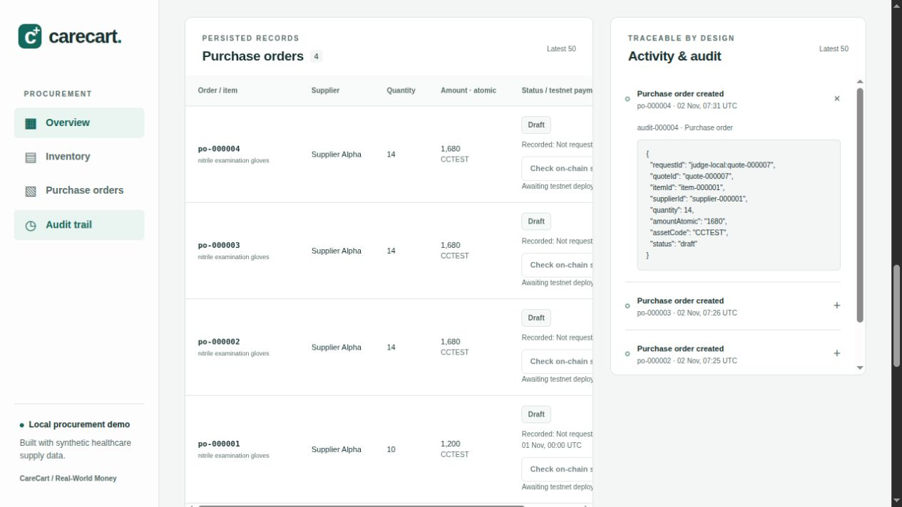
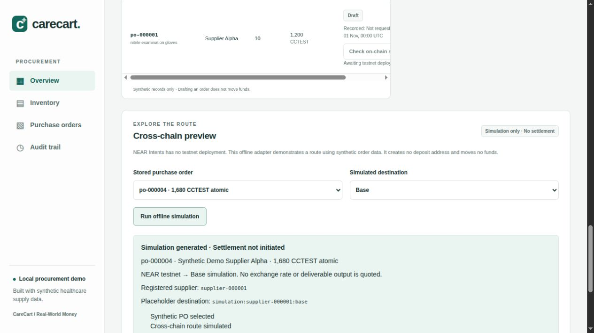

# CC-13 judge verification

> **Later deployment update (2026-11-02):** This is historical pre-deployment CC-13 evidence. The approved CC-15 setup now has deployed vault/token code and a paused vault with 10000 CCTEST; see [current deployment evidence](testnet-deployment.md). README step 3 now describes that public state. No live PO payment or browser-wallet signature is claimed.

Verified on **2026-11-02 (UTC)** using the numbered root [README](../README.md). The judge can run the local procurement UI/API and the real local Sandbox policy path without public signing or credentials.

## Clean-checkout method

The CC-09 through CC-13 source changes were uncommitted in the shared workspace. To test those changes without copying local runtime state, the non-ignored current source was copied into a temporary Git repository and cloned into `/tmp/carecart-cc13-whzumkt6/checkout`. That clone initially had no `node_modules`, `.next`, database, `.env`, or web environment file. Its Git status was clean.

Both lockfiles were installed independently, with a new temporary npm cache and install scripts disabled. The existing host Node/Rust/cargo-near installations, Cargo registry cache and cached Sandbox node binary were reused. Cargo build output went into a new `/tmp/carecart-cc13-whzumkt6/cargo-target`, not the workspace's existing target. This verifies a clean clone of the **current source snapshot**, not the remote repository's older committed HEAD or a fresh operating-system installation. The shared workspace was not committed, pushed, deployed or reset. Include these source changes in the release revision before expecting a remote clone to reproduce this feature set.

The example environment was copied into the clone; signing/provider credentials stayed empty and optional dry quotes stayed disabled. The separate web file contained only public backend/account IDs. The judge backend used a new `backend/data/judge.sqlite` on port 3101; the production web server used port 3102. Public NEAR testnet access was read-only. No wallet was connected and no public transaction was signed.

## Observed outcomes

| README action | Captured result |
| --- | --- |
| Install pinned Node packages | Backend: 186 packages; web: 359. A transient backend npm registry `ECONNRESET` was resolved by retrying the same locked install. No install scripts were enabled. |
| Build web with `--webpack` | Successful compile, TypeScript check and production output, including dashboard, proxy and read-only vault routes. |
| Start both servers | Backend 3101 and web 3102 start using only the example/public configuration. |
| View gloves | On hand 4, reorder point 12, fixed-window usage 27, supplier recommendations 11/14. |
| Generate quotes and draft | Fresh Alpha quote: quantity 14, amount `1680` CCTEST atomic. UI draft `po-000002` persisted across refresh with `quote-000003` and `audit-000002`. |
| Read audit details | The disclosure shows stored request, quote, item, supplier, quantity and amount. Later HTTP-created orders appear after Refresh data. |
| Inspect vault | Public RPC reports the configured vault is undeployed; UI says **Awaiting deployment** and disables contract actions. |
| Run cross-chain simulation | Same stored supplier/amount, synthetic placeholder destination, **Simulation generated · Settlement not initiated**, optional dry quotes unconfigured. |
| Run HTTP judge script twice | Both runs return `result: passed`; each creates one fresh synthetic PO, verifies replay, rejects payee/amount overrides with 400 and confirms preview changes no persisted PO/payment/audit data. |
| Run adversarial-message test | One targeted test passes; a message asking to redirect the PO cannot change Alpha or `1680`. The five other tests in that file are unselected by the filter, not disabled. |
| Run all backend tests/typecheck | 64 tests pass and strict typecheck succeeds. |
| Run web safety tests/lint | Six wallet/RPC cases pass; lint succeeds. Node emits a non-fatal module-type warning for native TypeScript loading. |
| Run fresh-output Rust workspace tests | 21 policy, 9 payment and 1 Sandbox test pass. Sandbox takes about 178 seconds in this run, including its contract builds. |

The [API report](judge-api-example.json) is the second script run: `quote-000007`, `po-000004`, supplier `supplier-000001`, amount `1680`, replay confirmed and `400 VALIDATION_ERROR` for an attempted override. These IDs are evidence from this run, not IDs to hardcode into a new run. See the [policy output excerpt](judge-policy-output.txt) for the real local adapter's paid/pending/blocked/failed result marker.

The browser console was clean. Order/audit disclosure and cross-chain results were manually checked in the clone's production build:

## Issues found and corrected

- The previous README omitted a complete install/config/start sequence and mixed implemented UI steps with future public deployment. The guide now has explicit ports, commands, expected outputs, dynamic quote/PO handling and separate local Sandbox policy verification.
- SQLite's active WAL/shared-memory files were visible as untracked files despite the database ignore. Ignore patterns now cover SQLite journals and companions; the running clone remains Git-clean.
- Refreshing after a newer PO appeared could change the selected PO while retaining a preview for an older one. The panel now shows a simulation only when its PO and chain match the current selection. Browser regression: simulate `po-000003`, create `po-000004` with the HTTP script, refresh, verify the old result disappears, then regenerate and see `po-000004`.

## Verification limits

No live LLM, testnet contract deployment, public payment, live wallet approval/policy/pause transaction, live 1Click quote or cross-chain settlement was performed. The optional dry adapter's documented schema is exercised with injected HTTP fixtures in backend tests; it is not configured in this run. CC-14 dependency/release review and CC-15 human-approved deployment remain separate tasks. A later mainnet cross-chain implementation is planned, not shipped here.
